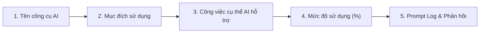

# BÁO CÁO & BẢN THUYẾT TRÌNH: QUY ĐỊNH SỬ DỤNG AI & CÔNG NGHỆ SỐ TRONG DỰ ÁN KHOA HỌC KỸ THUẬT

---

## 📌 PHẦN 1: TỔNG QUAN & TINH THẦN CỦA QUY ĐỊNH

### 1. Thông điệp cốt lõi từ Ban Tổ Chức & Công văn Sở GD&ĐT
> **"Công văn KHÔNG CẤM sử dụng AI. Thay vào đó, quy định đặt ra nhằm đảm bảo tính MINH BẠCH, LIÊM CHÍNH HỌC THUẬT và ĐÓNG GÓP THỰC CHẤT của học sinh."**

* AI và công nghệ số được nhìn nhận như **công cụ trợ lực (Co-pilot / Amplifier)** giúp tăng năng suất nghiên cứu, lập trình và mô phỏng.
* Tuyệt đối **không được biến sản phẩm do AI sinh ra thành kết quả nghiên cứu tự thân** mà không có sự thẩm định, chỉnh sửa, tích hợp và tư duy của học sinh.

---

## ⚖️ PHẦN 2: PHÂN ĐỊNH RÕ HAI TRƯỜNG HỢP THEO PHỤ LỤC 7

| Tiêu chí | Trường hợp 1: KHÔNG PHẢI KHAI BÁO | Trường hợp 2: BẮT BUỘC PHẢI KHAI BÁO (Phụ lục 7) |
| :--- | :--- | :--- |
| **Phạm vi công việc** | • Tra cứu tài liệu, tìm nguồn tham khảo ban đầu. • Kiểm tra lỗi chính tả, ngữ pháp tiếng Việt/tiếng Anh. | • Hỗ trợ lập trình, gỡ lỗi mã nguồn (Coding, Debugging). • Phân tích số liệu, xử lý thuật toán. • Tạo mô hình 3D, tối ưu hóa asset đồ họa, sơ đồ. • Biên soạn báo cáo tổng hợp, thiết kế poster triển lãm. |
| **Bản chất tác động** | Tác vụ hỗ trợ phụ trợ bề mặt văn bản, không can thiệp vào cấu trúc hay sản phẩm cốt lõi của đề tài. | Tác động trực tiếp vào việc hình thành sản phẩm dự thi (phần mềm, mô hình, dữ liệu báo cáo). |
| **Yêu cầu đối với học sinh** | Tự do sử dụng đúng mục đích. | **Phải điền đầy đủ Phiếu khai báo Phụ lục 7**, nêu rõ công cụ, mục đích, mức độ và đính kèm **Prompt Log**. |

---

## 🔍 PHẦN 3: NĂM (05) NỘI DUNG HỌC SINH CẦN KHAI BÁO MINH BẠCH

Khi dự án thuộc nhóm bắt buộc khai báo, hồ sơ dự thi phải trả lời tường minh 5 câu hỏi:

1. **Tên công cụ chính xác**: Nêu rõ phiên bản (Ví dụ: `Antigravity / Google Gemini Pro`, `Claude Sonnet 3.5`, `ChatGPT-4o`, `GitHub Copilot`...).
2. **Mục đích sử dụng**: Giải thích vì sao cần công cụ (Ví dụ: Hỗ trợ sinh boilerplate code React/TypeScript, chuẩn hóa cấu trúc JSON từ điển, gợi ý thuật toán âm thanh...).
3. **Mô tả công việc thực tế**: Liệt kê ranh giới công việc — *Phần nào AI gợi ý, phần nào học sinh tự tay viết và kiểm thử*.
4. **Khai báo mức độ sử dụng**: Định lượng tỷ lệ phần trăm hoặc mức độ đóng góp (Ví dụ: AI hỗ trợ 25% việc gợi ý cú pháp; học sinh đóng góp 75% về ý tưởng, cấu trúc hệ thống, kiểm nghiệm thực địa và tích hợp phần cứng/phần mềm).
5. **Prompt Log (Nhật ký câu lệnh)**:
   * Trích xuất các câu lệnh (Prompt) tiêu biểu và phản hồi tương ứng.
   * *Lưu ý an toàn:* Đã lược bỏ các thông tin nhận dạng cá nhân (PII) như họ tên, địa chỉ, tài khoản cá nhân.
   * Nếu không xuất được log toàn bộ, cung cấp **Bản tóm tắt chuỗi câu lệnh và kết quả áp dụng**.

---

## 🎤 PHẦN 4: GỢI Ý KỊCH BẢN THUYẾT TRÌNH TRƯỚC BAN GIÁM KHẢO (1 - 2 PHÚT)

> *"Kính thưa Ban Giám khảo,*
> 
> *Tuân thủ nghiêm ngặt tinh thần Công văn và Hướng dẫn tại Phụ lục 7 về Liêm chính Học thuật và Công nghệ số, nhóm chúng em xin được báo cáo minh bạch về việc ứng dụng Trí tuệ Nhân tạo trong dự án **CO TU HERITAGE AR** như sau:*
> 
> *1. **Quan điểm sử dụng**: Nhóm xác định AI là công cụ gia tốc kỹ thuật (Technical Accelerator), tuyệt đối không thay thế tư duy nghiên cứu và đóng góp thực chất của học sinh.*
> 
> *2. **Phân định công việc** Minh bạch:*
> * * **Phần học sinh làm chủ (100% Core Values)**: Ý tưởng tích hợp WebAR song ngữ cho di sản Cơ Tu Tây Giang; điền dã khảo sát hiện vật (Nhà Gươl, Cột tế, Trống, Đàn T'rứt, Gùi Ba-hiêng); thu thập tư liệu văn hóa bản địa; thiết kế trải nghiệm người dùng; kiểm thử tương thích thiết bị di động tại thực địa.*
> * * **Phần công nghệ số/AI hỗ trợ**: Trợ giúp kiểm tra cú pháp mã nguồn React/TypeScript, tối ưu hóa cấu trúc dữ liệu JSON song ngữ và gợi ý thuật toán tạo âm thanh ngũ cung.*
> 
> *3. **Hồ sơ minh chứng**: Toàn bộ lịch sử câu lệnh, mức độ can thiệp và phiếu khai báo đã được chúng em hoàn thiện đầy đủ, chi tiết tại **Phụ lục 7** đính kèm theo hồ sơ dự án.*
> 
> *Chúng em sẵn sàng trả lời và thực hiện trực tiếp mọi thao tác lập trình, phân tích dữ liệu trước Ban Giám khảo để chứng minh năng lực thực chất của nhóm."*

---

## 🛡️ PHẦN 5: BỘ NGUYÊN TẮC VÀNG DÀNH CHO THÍ SINH
1. **Thật thà là sức mạnh**: Giám khảo đánh giá rất cao thí sinh hiểu rõ công cụ mình dùng và dám khai báo minh bạch, chi tiết.
2. **Làm chủ sản phẩm**: Dù AI gợi ý bất kỳ dòng code hay đoạn văn nào, học sinh phải hiểu từng dòng, giải thích được logic và tự tay sửa đổi được khi Giám khảo yêu cầu.
3. **Lưu trữ bằng chứng**: Giữ lại các bản nháp, commit Git, ảnh chụp màn hình quá trình nghiên cứu thực tế làm minh chứng đối sánh.

