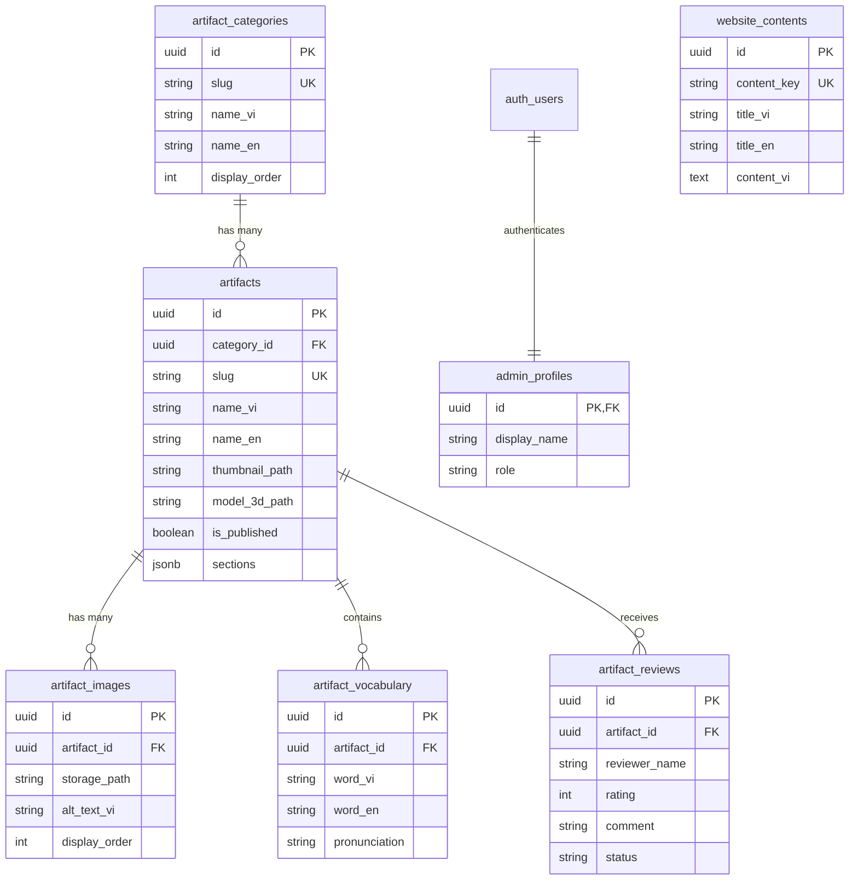

# DATABASE SCHEMA ARCHITECTURE: CO-TU HERITAGE AR
**Document Version:** 1.0.0  
**Phase:** Phase B (Database Architecture)  
**Database Engine:** PostgreSQL 15+ (Supabase)  

---

## 1. Architectural Overview

The **CO-TU HERITAGE AR** database is designed to deliver sub-millisecond query responses for public WebAR museum visitors while enforcing strict relational integrity, bilingual localization parity (Vietnamese and English), and multi-tenant administrative boundaries.

### Key Design Principles:
1. **Public Read-Only by Default:** The website is publicly accessible. Unauthenticated visitors can query published artifacts, categories, images, educational vocabulary, and approved reviews.
2. **Deterministic Foreign Keys & Cascades:** Deleting an artifact automatically cascades to its images, vocabulary, and anatomy metadata, while reviews set their foreign key to `NULL` to preserve platform analytics and guestbook history.
3. **Automated Timestamps:** All tables maintain `created_at` and `updated_at` timestamps governed by an automated trigger function `update_updated_at_column()`.
4. **Immutable Slugs:** Slug fields are unique indexes used for clean SEO URLs and QR code resolution, decoupling client routing from internal UUIDs.

---

## 2. Table Specifications

### 2.1. Table: `artifact_categories`
Stores artifact taxonomic categories (Architecture, Musical Instruments, Weaving & Brocade, Spiritual Sculpture, Daily Tools).

| Column | Type | Constraints | Description |
|---|---|---|---|
| `id` | `UUID` | `PRIMARY KEY DEFAULT gen_random_uuid()` | Unique category identifier |
| `name_vi` | `TEXT` | `NOT NULL` | Vietnamese category title |
| `name_en` | `TEXT` | `NOT NULL` | English category title |
| `slug` | `TEXT` | `UNIQUE NOT NULL` | URL / identifier slug (e.g. `architecture`) |
| `description_vi` | `TEXT` | `NULL` | Vietnamese anthropological overview |
| `description_en` | `TEXT` | `NULL` | English anthropological overview |
| `display_order` | `INTEGER` | `NOT NULL DEFAULT 0` | Ordering index for UI tabs and filters |
| `created_at` | `TIMESTAMPTZ` | `NOT NULL DEFAULT now()` | Record creation timestamp |
| `updated_at` | `TIMESTAMPTZ` | `NOT NULL DEFAULT now()` | Last update timestamp |

**Indexes:**
- `idx_artifact_categories_slug` on `slug` (`UNIQUE`)
- `idx_artifact_categories_display_order` on `display_order ASC`

---

### 2.2. Table: `artifacts`
The central entity representing tangible heritage items digitized into 3D and WebAR.

| Column | Type | Constraints | Description |
|---|---|---|---|
| `id` | `UUID` | `PRIMARY KEY DEFAULT gen_random_uuid()` | Unique artifact identifier |
| `category_id` | `UUID` | `REFERENCES artifact_categories(id) ON DELETE SET NULL` | Parent category foreign key |
| `slug` | `TEXT` | `UNIQUE NOT NULL` | URL routing & QR code key (`guol-communal-house`) |
| `name_vi` | `TEXT` | `NOT NULL` | Official Vietnamese artifact name |
| `name_en` | `TEXT` | `NULL` | English artifact name |
| `short_description_vi` | `TEXT` | `NULL` | 1-2 sentence Vietnamese teaser/brief |
| `short_description_en` | `TEXT` | `NULL` | 1-2 sentence English teaser/brief |
| `description_vi` | `TEXT` | `NULL` | Full Vietnamese cultural narrative |
| `description_en` | `TEXT` | `NULL` | Full English cultural narrative |
| `origin_vi` | `TEXT` | `NULL` | Geographic origin (e.g., Xã A Tiêng, Tây Giang) |
| `origin_en` | `TEXT` | `NULL` | English geographic origin |
| `materials_vi` | `TEXT` | `NULL` | Raw materials (e.g., Gỗ kiền kiền, mây rừng) |
| `materials_en` | `TEXT` | `NULL` | English materials (e.g., Shorea timber, rattan) |
| `dimensions` | `TEXT` | `NULL` | Physical dimensions |
| `historical_story_vi` | `TEXT` | `NULL` | Primary historical section text (VI) |
| `historical_story_en` | `TEXT` | `NULL` | Primary historical section text (EN) |
| `cultural_meaning_vi` | `TEXT` | `NULL` | Spiritual / cosmic significance (VI) |
| `cultural_meaning_en` | `TEXT` | `NULL` | Spiritual / cosmic significance (EN) |
| `thumbnail_path` | `TEXT` | `NULL` | Storage path or CDN URL for preview image |
| `model_3d_path` | `TEXT` | `NULL` | Storage path or CDN URL for `.glb` 3D model |
| `model_status` | `TEXT` | `NOT NULL DEFAULT 'available'` | Status: `'available'`, `'coming_soon'`, `'missing'` |
| `content_status` | `TEXT` | `NOT NULL DEFAULT 'verified'` | Verification: `'verified'`, `'pending_verification'`, `'illustrative'` |
| `verification_note` | `TEXT` | `NULL` | Expert validation or ethnographic provenance note |
| `sources` | `TEXT[]` | `DEFAULT '{}'` | Array of bibliographic and field sources |
| `audio_vi_path` | `TEXT` | `NULL` | Voice guide audio path (Vietnamese) |
| `audio_en_path` | `TEXT` | `NULL` | Voice guide audio path (English) |
| `qr_code` | `TEXT` | `NULL` | Physical exhibit QR tracking code |
| `sections` | `JSONB` | `DEFAULT '[]'::jsonb` | Structured subsections (Joinery, Carving, etc.) |
| `is_published` | `BOOLEAN` | `NOT NULL DEFAULT FALSE` | Visibility flag for public visitors |
| `display_order` | `INTEGER` | `NOT NULL DEFAULT 0` | Showcase sorting order on homepage |
| `created_at` | `TIMESTAMPTZ` | `NOT NULL DEFAULT now()` | Record creation timestamp |
| `updated_at` | `TIMESTAMPTZ` | `NOT NULL DEFAULT now()` | Last update timestamp |

**Indexes:**
- `idx_artifacts_slug` on `slug` (`UNIQUE`)
- `idx_artifacts_category_id` on `category_id`
- `idx_artifacts_is_published` on `is_published`
- `idx_artifacts_display_order` on `display_order ASC`

---

### 2.3. Table: `artifact_images`
One-to-many relationship supporting multi-angle field documentation, photogrammetry renders, and museum gallery displays.

| Column | Type | Constraints | Description |
|---|---|---|---|
| `id` | `UUID` | `PRIMARY KEY DEFAULT gen_random_uuid()` | Image record identifier |
| `artifact_id` | `UUID` | `NOT NULL REFERENCES artifacts(id) ON DELETE CASCADE` | Associated artifact |
| `storage_path` | `TEXT` | `NOT NULL` | Path within `artifact-images` bucket |
| `alt_text_vi` | `TEXT` | `NULL` | Vietnamese accessibility label |
| `alt_text_en` | `TEXT` | `NULL` | English accessibility label |
| `display_order` | `INTEGER` | `NOT NULL DEFAULT 0` | Carousel / gallery display order |
| `created_at` | `TIMESTAMPTZ` | `NOT NULL DEFAULT now()` | Upload timestamp |

**Indexes:**
- `idx_artifact_images_artifact_id` on `artifact_id`
- `idx_artifact_images_display_order` on `display_order ASC`

---

### 2.4. Table: `artifact_vocabulary`
Contextual linguistic and ethnographic vocabulary terms mapped to artifacts for educational flashcards and quizzes.

| Column | Type | Constraints | Description |
|---|---|---|---|
| `id` | `UUID` | `PRIMARY KEY DEFAULT gen_random_uuid()` | Vocabulary item identifier |
| `artifact_id` | `UUID` | `REFERENCES artifacts(id) ON DELETE CASCADE` | Associated artifact (optional for general terms) |
| `word_vi` | `TEXT` | `NOT NULL` | Vietnamese term / meaning |
| `word_en` | `TEXT` | `NOT NULL` | English academic or technical term |
| `pronunciation` | `TEXT` | `NULL` | International Phonetic Alphabet (IPA) |
| `definition_vi` | `TEXT` | `NULL` | Detailed Vietnamese anthropological definition |
| `definition_en` | `TEXT` | `NULL` | Detailed English anthropological definition |
| `example_vi` | `TEXT` | `NULL` | Vietnamese contextual usage sentence |
| `example_en` | `TEXT` | `NULL` | English contextual usage sentence |
| `display_order` | `INTEGER` | `NOT NULL DEFAULT 0` | Ordering index within artifact detail view |
| `created_at` | `TIMESTAMPTZ` | `NOT NULL DEFAULT now()` | Creation timestamp |
| `updated_at` | `TIMESTAMPTZ` | `NOT NULL DEFAULT now()` | Last update timestamp |

**Indexes:**
- `idx_artifact_vocabulary_artifact_id` on `artifact_id`
- `idx_artifact_vocabulary_display_order` on `display_order ASC`

---

### 2.5. Table: `artifact_reviews`
Public guestbook and expert feedback records with moderation workflow.

| Column | Type | Constraints | Description |
|---|---|---|---|
| `id` | `UUID` | `PRIMARY KEY DEFAULT gen_random_uuid()` | Review identifier |
| `artifact_id` | `UUID` | `REFERENCES artifacts(id) ON DELETE SET NULL` | Target artifact (`NULL` for site-wide review) |
| `reviewer_name` | `TEXT` | `NULL` | Visitor display name |
| `reviewer_role_vi` | `TEXT` | `NULL` | Reviewer affiliation (e.g., GV Lịch sử Tây Giang) |
| `reviewer_role_en` | `TEXT` | `NULL` | English affiliation |
| `avatar_bg` | `TEXT` | `NULL` | UI avatar gradient style |
| `avatar_initials` | `TEXT` | `NULL` | Two-letter initials |
| `badge_vi` | `TEXT` | `NULL` | Cultural badge (e.g., Nghệ nhân bản địa) |
| `badge_en` | `TEXT` | `NULL` | English badge |
| `rating` | `INTEGER` | `NOT NULL CHECK (rating BETWEEN 1 AND 5)` | 1 to 5 star rating |
| `comment` | `TEXT` | `NOT NULL` | Written review content |
| `status` | `TEXT` | `NOT NULL DEFAULT 'pending' CHECK (status IN ('pending', 'approved', 'rejected'))` | Moderation state |
| `likes` | `INTEGER` | `NOT NULL DEFAULT 0` | Helpful upvotes |
| `is_verified` | `BOOLEAN` | `NOT NULL DEFAULT FALSE` | Verified researcher or educator badge |
| `created_at` | `TIMESTAMPTZ` | `NOT NULL DEFAULT now()` | Submission timestamp |
| `updated_at` | `TIMESTAMPTZ` | `NOT NULL DEFAULT now()` | Last moderation timestamp |

**Indexes:**
- `idx_artifact_reviews_artifact_id` on `artifact_id`
- `idx_artifact_reviews_status` on `status`
- `idx_artifact_reviews_created_at` on `created_at DESC`

---

### 2.6. Table: `website_contents`
Key-value content repository for dynamically managing website copy, banners, and homepage narratives.

| Column | Type | Constraints | Description |
|---|---|---|---|
| `id` | `UUID` | `PRIMARY KEY DEFAULT gen_random_uuid()` | Content block identifier |
| `content_key` | `TEXT` | `UNIQUE NOT NULL` | Functional lookup key (`home_hero`, `about_project`) |
| `title_vi` | `TEXT` | `NULL` | Vietnamese headline |
| `title_en` | `TEXT` | `NULL` | English headline |
| `content_vi` | `TEXT` | `NULL` | Vietnamese body text / markdown |
| `content_en` | `TEXT` | `NULL` | English body text / markdown |
| `image_path` | `TEXT` | `NULL` | Associated asset path in `website-assets` |
| `updated_at` | `TIMESTAMPTZ` | `NOT NULL DEFAULT now()` | Last update timestamp |

**Indexes:**
- `idx_website_contents_key` on `content_key` (`UNIQUE`)

---

### 2.7. Table: `admin_profiles`
Secure administrative directory linked directly to `auth.users(id)`.

| Column | Type | Constraints | Description |
|---|---|---|---|
| `id` | `UUID` | `PRIMARY KEY REFERENCES auth.users(id) ON DELETE CASCADE` | Supabase Auth user ID |
| `display_name` | `TEXT` | `NULL` | Administrator full name |
| `role` | `TEXT` | `NOT NULL DEFAULT 'admin' CHECK (role IN ('admin', 'super_admin'))` | Administrative privilege level |
| `created_at` | `TIMESTAMPTZ` | `NOT NULL DEFAULT now()` | Provisioning timestamp |

---

## 3. Entity-Relationship Diagram

